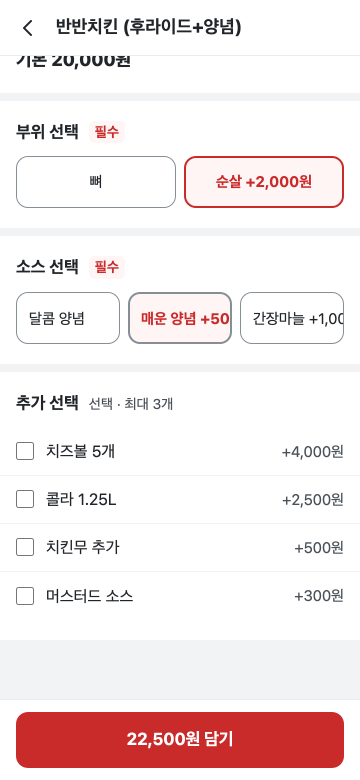

# Persona QA: execution and analysis checks

The live pilot did not establish a detection gain from instruction edits. A separate review of one identical recording found one more supported issue when the existing analyzer's output was supplied. That small result supports exposing analysis output, not a general claim that synthetic personas predict real users or that the full skill is faster or more accurate.

## Changes

- Put audience-based profile composition and profile-bound recording/analysis together in the QA instructions. Keep initial observation possible, preserve research references, and allow bounded or explicitly single-condition work.
- Keep baseline profiles separate from clean UI controls. Condition attribution requires an executed comparison that changes one facet. Shared-recording analysis, scripted replay and persona-operated behavior remain distinct.
- Reduce duplicate reading and stop routing standalone QA through the full improvement instructions. Original first-read closure: 41,983 bytes; rejected first candidate: 45,402; corrected instruction candidate: 41,708. The final driver guidance is checked against the same unchanged limits. These are file-byte budgets, not measured inference-cost savings.
- Fix standalone audience composition exports. Their provenance now stays under `scenario_assumptions.audience_composition`. Explicit or malformed research references still go through the unchanged strict validator. No research records or claim IDs are invented.
- Add `--analyze` to the existing browser driver and the persona-QA example. It invokes the existing analyzer once after recording and browser close, returning report paths and screening counts. Product success stays separate from analysis success. Inputs are frozen, private data is sanitized, existing reports are preserved, and failures remain explicit.

## Live instruction pilot

Existing delivery-order variants, the same fictional product brief and brief-derived audience, Galaxy S24 Chromium emulation, same configured model and tools. One fresh operator per condition. Four planned runs each: two selected profiles across two page variants. Limits were fixed before dispatch: 35 browser actions per run and 25 minutes of observation, followed by report-only closeout.

| Condition | Supported seeded families / 12 | Core false positives | Completed within cutoff / 4 | Total eventually completed / 4 | Analyzer artifacts |
| --- | ---: | ---: | ---: | ---: | ---: |
| No skill | 2 | 0 | 1 | 1 | 0 |
| Original skill | 3 | 0 | 1 | 1 | 0 |
| First candidate, rejected reading budget | 2 | 1 | 1 | 1 | 0 |
| Corrected instruction candidate | 3 | 0 | 1 | 2 | 0 |

The corrected candidate's second task first shows completion at 11:57:25 UTC, about 12 seconds after its 11:57:13 cutoff. The previous snapshot at 11:57:11 still shows checkout. Count that completion in the eventual total, not in the equal-time result. The supervisor's stop message was delivered at about 11:57:27; that delay is retained.

The first candidate selected a matched left/right pair but changed the prescribed run order and did not complete the pair. The other arms selected profiles differing in several attributes. No live matched persona comparison completed. Generated profile counts therefore do not establish executed profile coverage or physical effects.

All arms missed some assigned work. The original and corrected instruction candidates each found three issue families. The predeclared improvement condition was not met. The failed first candidate and partial runs remain in the records; they were not discarded in favor of a better result.

## Same-recording analysis-output comparison

Two fresh reviewers received the exact same completed 22-step recording and its profile. One received only the recording; the other also received the existing deterministic analyzer's output. Both had 15 minutes of inspection and no new UI interaction, source-code access or defect-key access. The recording-only reviewer used report-only closeout after the inspection cutoff; complete elapsed reporting time remains in the counters. An independent reviewer adjudicated anonymous report labels against the stored evidence and frozen source/key.

| Measure | Recording only | Recording plus analyzer output |
| --- | ---: | ---: |
| Supported seed families | 4 | 5 |
| Unsupported core findings | 0 | 0 |
| Core false positives | 0 | 0 |
| Withheld hypotheses | 4 | 7 |
| Severity elevations not established by the recording | 0 | 2 |

Both found part-control semantics, unnamed quantity controls, extra-option row activation and generic coupon errors. The assisted review also found clipped sauce prices. This is one additional family in one case, not nine independent discoveries or a population result.

Core matches do not make every subclaim correct. The assisted review overstated two severity levels, treated a catalog-derived millimeter estimate too strongly, and extended a measured plus-button paint box to the minus button without support. The record contains no physical grip, tremor or screen-reader trial. Hypotheses withheld from findings were not counted as false positives. Neither this result nor the live pilot establishes a broad accuracy, speed or dollar-cost advantage.

## Scripted pipeline and export repair

Two composed profiles, AP-01 and its left-hand mirror AP-03, replayed both unchanged existing scenarios using the existing driver. All four reached the authored success selector. This verifies execution and record creation; the intentionally defective variant is not declared to preserve all input values or to pass QA.

The analyzer produced 13 screening units. Its existing scorer matched 4 of 12 seeds strictly and flagged four clean-control units, including one P2. These raw automated candidates require review. This diagnostic is separate from the operator comparison and does not claim a newly improved detector.

The original exported evidence bundle failed validation because standalone composition metadata was treated as a research link. After the export repair, the bundle for the same four recordings validates. `findings.json` and `analyses.json` remain byte-for-byte identical; no detector rule, benchmark key, severity threshold or observation was changed to pass validation.

## Verification and boundaries

[Machine-readable verification receipts](verification.json) separate installed execution, local tests, reruns and CI.

- Corrected instruction version: 1,086 Python tests, no failures, one skip; 32 packaging checks; 13 reading-budget checks; independent instruction review and 18 targeted contract checks.
- Final installed driver: the unchanged 40-step delivery scenario completed and automatically produced all three analysis reports; the installed HTTP finish path did likewise. The single-command installer updated the isolated installation, created its backup and verified all 232 payload files. Final payload: `51a2a118d6a2934a890ae2111b315725f1baf08db92a89b2f87abe7e0ce572b2`.
- Final analysis boundary tests: 65 passed, zero failed, including private locators/ARIA links, late private input, idempotence, output validation, failed interpreters, shared finish budget and unchanged CG-02 semantics.
- Export repair: 1,087 Python tests, no failures, one skip; one meaningful round-trip regression with nine input/reference cases; independent code review; actual four-recording bundle validation and output-equality check.
- Local full driver checks before the final ARIA-reference correction recorded 620 passes and three existing focus-test failures. The isolated focus group then passed 33/33 with unchanged criteria. An earlier full run recorded 599 passes and two timing failures; isolated scripted/actions checks passed 114/114. Retain both failed full runs rather than presenting only reruns as a clean full-suite result.
- Initial sandbox test failures were localhost-server permission failures. The identical suite passed with authorized local-server execution. The first candidate's reading-budget failures were real and were fixed without raising limits.
- Models were requested and reported as `inferhub/combo-deepseek-4-1-flash`, effort `ultra`; the backend identity was not independently attested. Reported token counters include cached and repeated host/tool context. They are not billed cost.
- Command auditing found no defect-key, fixture-source or other-operator reads. The no-skill operator listed the local site directory while checking transport; it did not read page source. This is protocol separation, not an operating-system isolation guarantee.
- This uses known synthetic development fixtures. It is not a held-out product evaluation, live community research, a Figma change, a real-device test, or a measurement of human preference, discomfort or prevalence.
- Evidence-copy omissions for relative/nested paths were corrected from the original stored files before final adjudication. Original PNGs were not changed. Timing and protocol deviations remain visible.

The final driver options invoke the existing analysis CLI inside the existing memoized finish method. The analyzer has a maximum 30-second budget within a shared 110-second finish budget; client requests retain their 120-second timeout. Insufficient time and failed/malformed analysis output are explicit failures, while the recorded product outcome remains unchanged. Temporary analysis inputs retain structural identifiers and profile provenance while omitting protected inputs and replacing protected locators with stable analytical bindings. Such locators cannot be replayed as original page selectors.

The repository keeps one installable skill with research, persona QA, ergonomics, loop and bundled search. The work reuses the existing driver, analyzer and tests; it adds no agent coordinator, service or execution harness.

## Inspect the evidence

- [Fixed live protocol](protocol.md), [same-recording protocol](receipt-protocol.md), [exact results and counters](results.json), [task command audit](read-audit.json).
- [Live adjudications](adjudication-live.json), [receipt-study adjudications](adjudication-receipt.json), [readable receipt-study review](receipt-review.md), [cutoff accounting](deadline-enforcement.json).
- [Installed acceptance artifacts](local-evidence/installed-acceptance.tar.gz) and [hashes](local-evidence/installed-receipts.json); extract with `tar -xzf local-evidence/installed-acceptance.tar.gz`.
- [Selected captures and original operator reports](local-evidence/captures.tar.gz), [file hashes and coverage](local-evidence/receipts.json). Extract from this directory with `tar -xzf local-evidence/captures.tar.gz`. The archive contains 249 files, including the complete common recording, cited live captures, profiles/prompts and scripted summaries. PNGs are unchanged; text paths are normalized. Other original captures remain in the task archive.
- `<repo-root>` references point to the unchanged benchmark files at baseline `ba090fe832799beeee1ea76167ac70954b9f7c2c`. `local-evidence/` paths refer to extracted evidence. Known duplicated capture inventories were omitted from the published adjudication summaries; per-finding qualifications are retained.

The extra finding in the receipt study is visible in the clipped sauce-price labels:

